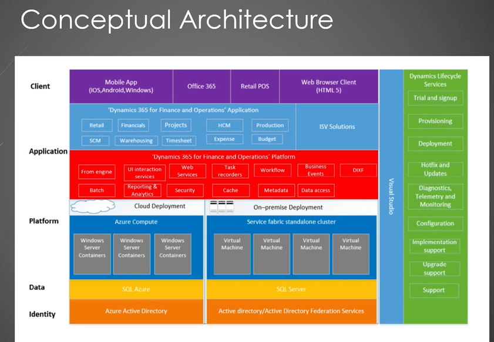

https://learn.microsoft.com/en-us/training/modules/finance-operations-developer-environment/models-packages

https://www.youtube.com/@ERPCoder/videos

https://www.youtube.com/watch?v=jhXDN1MhG6c&t=2s

https://www.youtube.com/@peterramer/playlists

https://www.youtube.com/watch?v=8vS32iUoSm0&list=PLelARlgcXqy4RDYnqJXYqBqk5DNyX49DO



UDEMY TRAINING: https://www.udemy.com/course/x-plus-plus-programming-fundamentals-for-d365-fo/learn/lecture/39797708#overview

Same Author: https://www.rummanansari.com/

Reading : https://learn.microsoft.com/en-us/training/paths/introduction-develop-finance-operations/

MB-500 (Developer Exam) : https://learn.microsoft.com/en-us/credentials/certifications/d365-finance-and-operations-apps-developer-associate/?practice-assessment-type=certification

FDD : Functional Design Document.

What is FDD ? 
A FDD is a comprehensive guide that details the functionality of a software or application. 

AOT Overview
______
Application object tree.It is a key feature of Microsoft Dynamics 365 F&O development environment. It is a hierarchical repository that stores all the application elements such as tables, forms classes, menus and reports, that make up a D365 F & O Solution. 

The AOT can be thought of as the central hub for managing and organizing all the application objects in D365 F&O. Developers use the AOT to create,modify and maintain application elements in the system. It provides a user-friendly interface that allows developers to browse,search and access all the application objects. 


Identifier
______
An identifier is a name given to a variable, function, class object or any other user-defined item. Identifiers are used to uniquely identify and refer to these entities within a program.

Read-only fields can be assigned a value only one time and that value never changes.

```x++
internal final class RunnableClass
{
    /// <summary>
    /// Class entry point. The system will call this method when a designated menu 
    /// is selected or when execution starts and this class is set as the startup class.
    /// </summary>
    /// <param name = "_args">The specified arguments.</param>
    public static void main(Args _args)
    {
        int myInt;
        int64 myInt64;
        real myReal;
        str myStr;
        boolean myBool;
        date myDate;
        TimeOfDay myTimeOfDay;
        container myContainer;
        guid myGuid;

        // Print the default values of the variables
        info(strFmt("Default value of int: %1", myInt));
        info(strFmt("Default value of int64: %1", myInt64));
        info(strFmt("Default value of real: %1", myReal));
        info(strFmt("Default value of str: %1", myStr));
        info(strFmt("Default value of boolean: %1", myBool));
        info(strFmt("Default value of date: %1", myDate));
        info(strFmt("Default value of time: %1", time2Str(myTimeOfDay, TimeSeparator::Colon, TimeFormat::AMPM)));
        info(strFmt("Default value of container: %1", con2Str(myContainer)));
        info(strFmt("Default value of guid: %1", myGuid));
    }

}
```

```x++
internal final class RunnableClass
{
    /// <summary>
    /// Class entry point. The system will call this method when a designated menu 
    /// is selected or when execution starts and this class is set as the startup class.
    /// </summary>
    /// <param name = "_args">The specified arguments.</param>
    public static void main(Args _args)
    {
        int myInt = 12342;
        int64 myInt64 = 123456789;
        real myReal = 123.45;
        str myStr = "Hello, World!";
        boolean myBool = true;
        date myDate = systemDateGet();
        TimeOfDay myTimeOfDay = timeOfDay();
        container myContainer = ["Item1", "Item2"];
        guid myGuid = guid::newGuid();
        utcdatetime myUtcDateTime = DateTimeUtil::getSystemDateTime();

        // Print the default values of the variables
        info(strFmt("Default value of int: %1", myInt));
        info(strFmt("Default value of int64: %1", myInt64));
        info(strFmt("Default value of real: %1", myReal));
        info(strFmt("Default value of str: %1", myStr));
        info(strFmt("Default value of boolean: %1", myBool));
        info(strFmt("Default value of date: %1", myDate));
        info(strFmt("Default value of time: %1", time2Str(myTimeOfDay, TimeSeparator::Colon, TimeFormat::AMPM)));
        info(strFmt("Default value of container: %1", con2Str(myContainer)));
        info(strFmt("Default value of guid: %1", myGuid));
    }

}
```

Base Enumerations
______
Also called Base Enum, it's more of HTML Select with integer as the underlying value. It's a list of literals with an assigned value. Their values are represented internally as integers and they are stored in the DB as a number which saves space.

So when creating the Base Enum items, remember to give it a Label and Name. The Label is what the users see.

```x++
PresenceStatus status;

status = PresenceStatus::Available;

info(strFmt("Presence status: %1", status));
```

```x++
PresenceStatus status1, status2, status3;
```

Extended Data Type
_______
These are also called User Defined types based on the primitive data types boolean,integer, real, string and date and the composite type Container.

Using descriptive EDTs can enhance code readability. For instance, instead of using a generic string data type for a field that represents postal codes, you can create an EDT named "PostalCode" to make your code more self-explanatory.

Readability 
```x++
str code;
PostalCode postalCode; // this EDT string is better than the pure str above.
```

Reusability : EDTs can be reused in multiple tables and fields, reducing redundancy and simplifying data management. When you make changes to an EDT , those changes are automatically applied wherever the EDT is used. 

Better to use an EDT since the functionality can be shared.

Get Inputs from Users
________

```x++
str name[2];
Dialog dialog = new Dialog("Enter Information");

DialogField firstName = dialog.addField(extendedTypeStr(String50));    
DialogField lastName = dialog.addField(extendedTypeStr(String50));

firstName.label("Enter first name");
lastName.label("Enter last name");  

if(dialog.run())
{
    name[1] = firstName.value();
    name[2] = lastName.value();
    info(strFmt("First Name: %1 Last Name: %2", name[1], name[2]));
}
else
{
    info("Dialog was canceled.");
}
```