https://learn.microsoft.com/en-us/training/modules/finance-operations-developer-environment/models-packages

https://www.youtube.com/@ERPCoder/videos

https://www.youtube.com/watch?v=jhXDN1MhG6c&t=2s

https://www.youtube.com/@peterramer/playlists

https://www.youtube.com/watch?v=8vS32iUoSm0&list=PLelARlgcXqy4RDYnqJXYqBqk5DNyX49DO

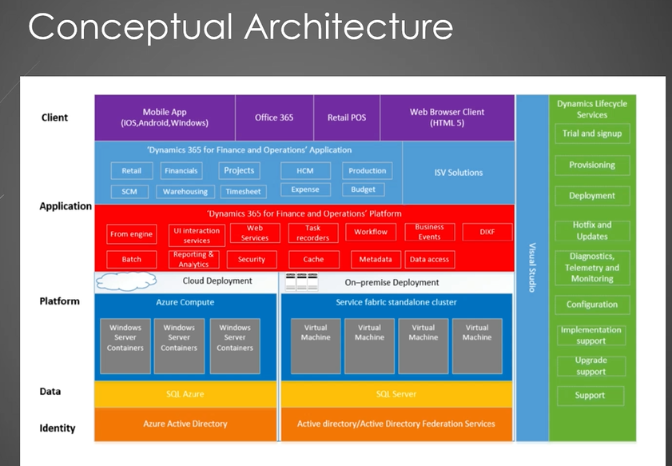

UDEMY TRAINING: https://www.udemy.com/course/x-plus-plus-programming-fundamentals-for-d365-fo/learn/lecture/39797708#overview

Same Author: https://www.rummanansari.com/

Reading : https://learn.microsoft.com/en-us/training/paths/introduction-develop-finance-operations/

MB-500 (Developer Exam) : https://learn.microsoft.com/en-us/credentials/certifications/d365-finance-and-operations-apps-developer-associate/?practice-assessment-type=certification

https://www.youtube.com/@peterramer

Short Hours : https://www.udemy.com/course/fundamentals-for-d365-fo/learn/lecture/54409619#overview

https://learn.microsoft.com/en-us/training/modules/get-started-xpp-finance-operations/

https://learn.microsoft.com/en-us/dynamics365/fin-ops-core/fin-ops/get-started/videos

FDD : Functional Design Document.

What is FDD ? 
A FDD is a comprehensive guide that details the functionality of a software or application. 

AOT Overview
______
Application object tree.It is a key feature of Microsoft Dynamics 365 F&O development environment. It is a hierarchical repository that stores all the application elements such as tables, forms classes, menus and reports, that make up a D365 F & O Solution. 

The AOT can be thought of as the central hub for managing and organizing all the application objects in D365 F&O. Developers use the AOT to create,modify and maintain application elements in the system. It provides a user-friendly interface that allows developers to browse,search and access all the application objects. 


Identifier
______
An identifier is a name given to a variable, function, class object or any other user-defined item. Identifiers are used to uniquely identify and refer to these entities within a program.

Read-only fields can be assigned a value only one time and that value never changes.

```x++
internal final class RunnableClass
{
    /// <summary>
    /// Class entry point. The system will call this method when a designated menu 
    /// is selected or when execution starts and this class is set as the startup class.
    /// </summary>
    /// <param name = "_args">The specified arguments.</param>
    public static void main(Args _args)
    {
        int myInt;
        int64 myInt64;
        real myReal;
        str myStr;
        boolean myBool;
        date myDate;
        TimeOfDay myTimeOfDay;
        container myContainer;
        guid myGuid;

        // Print the default values of the variables
        info(strFmt("Default value of int: %1", myInt));
        info(strFmt("Default value of int64: %1", myInt64));
        info(strFmt("Default value of real: %1", myReal));
        info(strFmt("Default value of str: %1", myStr));
        info(strFmt("Default value of boolean: %1", myBool));
        info(strFmt("Default value of date: %1", myDate));
        info(strFmt("Default value of time: %1", time2Str(myTimeOfDay, TimeSeparator::Colon, TimeFormat::AMPM)));
        info(strFmt("Default value of container: %1", con2Str(myContainer)));
        info(strFmt("Default value of guid: %1", myGuid));
    }

}
```

```x++
internal final class RunnableClass
{
    /// <summary>
    /// Class entry point. The system will call this method when a designated menu 
    /// is selected or when execution starts and this class is set as the startup class.
    /// </summary>
    /// <param name = "_args">The specified arguments.</param>
    public static void main(Args _args)
    {
        int myInt = 12342;
        int64 myInt64 = 123456789;
        real myReal = 123.45;
        str myStr = "Hello, World!";
        boolean myBool = true;
        date myDate = systemDateGet();
        TimeOfDay myTimeOfDay = timeOfDay();
        container myContainer = ["Item1", "Item2"];
        guid myGuid = guid::newGuid();
        utcdatetime myUtcDateTime = DateTimeUtil::getSystemDateTime();

        // Print the default values of the variables
        info(strFmt("Default value of int: %1", myInt));
        info(strFmt("Default value of int64: %1", myInt64));
        info(strFmt("Default value of real: %1", myReal));
        info(strFmt("Default value of str: %1", myStr));
        info(strFmt("Default value of boolean: %1", myBool));
        info(strFmt("Default value of date: %1", myDate));
        info(strFmt("Default value of time: %1", time2Str(myTimeOfDay, TimeSeparator::Colon, TimeFormat::AMPM)));
        info(strFmt("Default value of container: %1", con2Str(myContainer)));
        info(strFmt("Default value of guid: %1", myGuid));
    }

}
```

Base Enumerations
______
Also called Base Enum, it's more of HTML Select with integer as the underlying value. It's a list of literals with an assigned value. Their values are represented internally as integers and they are stored in the DB as a number which saves space.

So when creating the Base Enum items, remember to give it a Label and Name. The Label is what the users see.

```x++
PresenceStatus status;

status = PresenceStatus::Available;

info(strFmt("Presence status: %1", status));
```

```x++
PresenceStatus status1, status2, status3;
```

Extended Data Type
_______
These are also called User Defined types based on the primitive data types boolean,integer, real, string and date and the composite type Container.

Composite data types are for aggregating data for primitive types. 

Using descriptive EDTs can enhance code readability. For instance, instead of using a generic string data type for a field that represents postal codes, you can create an EDT named "PostalCode" to make your code more self-explanatory.

Readability 
```x++
str code;
PostalCode postalCode; // this EDT string is better than the pure str above.
```

Reusability : EDTs can be reused in multiple tables and fields, reducing redundancy and simplifying data management. When you make changes to an EDT , those changes are automatically applied wherever the EDT is used. 

Better to use an EDT since the functionality can be shared.

The names of extended data types should reflect the real-world items they model.  If the EDT belongs to an application module (such as customers or vendors), the name must be prefixed with the name of the module
(Cust, Vend and so on).

If it is a data type for identification purposes such as for a key field in a table, the name must be postfixed with "Id". For example, JournalId, CustGroupId and VendId other common postfix terms can also be used, but avoid "Code", "Num" and "Type".

e.g triEmployeeId i.e companyVariableName (best convention)

NOTE : Do not set the Label property to the same value as the HelpText property. The label should be defined at the most generic place, and not be duplicated down the hierarchy.

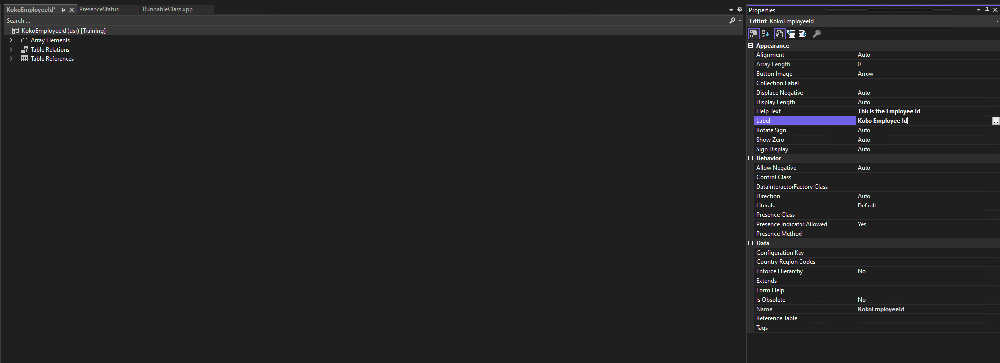

For EDTEnum, it's best we create a base enum and point the EDT Enum Type we created to it in the Enum Type properties.

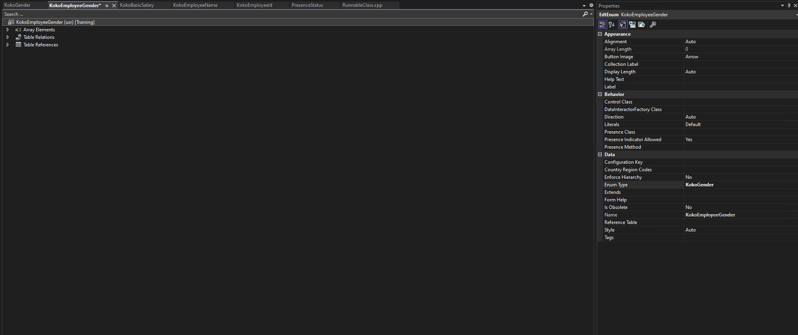

So we can use it directly in the code rather than the primitive types. In real world projects use EDT rather than primitive types. Create an EDT for each atomic entity in the situation that your application is modeling.

Use an extended data type wherever possible.

```x++
        KokoEmployeeId EmployeeId;
        KokoEmployeeName employeeName;
         KokoGender employeeGender = KokoGender::Male;
```

Get Inputs from Users
________

```x++
str name[2];
Dialog dialog = new Dialog("Enter Information");

DialogField firstName = dialog.addField(extendedTypeStr(String50));    
DialogField lastName = dialog.addField(extendedTypeStr(String50));

firstName.label("Enter first name");
lastName.label("Enter last name");  

if(dialog.run())
{
    name[1] = firstName.value();
    name[2] = lastName.value();
    info(strFmt("First Name: %1 Last Name: %2", name[1], name[2]));
}
else
{
    info("Dialog was canceled.");
}
```

The == and != operators are case insensitive in X++ but case sensitive in C# so "Hello" == "hello" is true in X++

Tables
______
Tables can also contain metadata, which is descriptive data such as system settings. Developers can modify existing table properties and components through extension, or they can create new tables.  

Tables are made up of fields, which are organized into field groups. 

Fields : Make up the data in the table and can be base enumerations or extended data types.   

Field Groups : Are logical groupings of physical database fields. Groups can be used on forms and reports so that when a modification is made to a field group, related objects are automatically updated to reflect the new content of the group.

Delete Actions : It is used to detail what should happen when data in a related table is deleted. With F&O , delete actions are specified on the properties of a table relation.

State Machines :  enable you to perform state transitions within the workflow without writing any additional code. These are primarily used with workflows.  

Mappings : with a map, you can associate a map field with a field in one or more tables. This enables you to use the same field name to access fields with different names in different tables.  

Methods are pieces of code that are added to a table that can be run when certain events or changes in the data occur. 

Events : are also pieces of code that are raised as preceding and succeeding operations around base methods.

To see all the tables, go to the AOT > Data Model > Tables

So after adding a table, we need to sync the table so it can appear in the DB and then we build the project. After these 2 steps then the table appears.

LABEL : will be added from a label file.

Table Properties
_______

 - Title Field1 : This is the key field for the records in the table and use a descriptive title if the key field has the information for the user.
 - Title Field2 : This is a descriptive field for the records in the table.
 - Do not set this property if there are not enough fields (according to your needs) in the table. Fields are type real or integer should not be used as title fields.
 - If the value of TitleField1 and TitleField2 is the same, an error occurs.
  
While many properties can be manipulated, only a few will commonly be used.

1. Table Type : Determines if the table is considered a regular database table or a temporary table such as Regular, TempDB or InMemory.  
2. Name : in a form to display in the user interface as a page, the name is what the user will see on the page. Names and labels should use camel case for consistency, but table names will display in capital letters.
3. Label : will be added from a label file and is used to identify the table in visual studio
4. Primary Index: Specifies the field by which the table should be used as the primary index and is used for database optimization purposed.
5. Cluster Index : Specifies the field by which the table should be organized. This property should never be left blank.
6. Configuration Key: Allows a system administrator to enable and disable certain of the application and ensures that a table is removed when the key is disabled.
    
7. Support Inheritance : Determines whether the table can become a base table by using inheritance. Setting this property to YES indicates that this table can be extended or that it can inherit properties from an existing table.
8. Extends : used when the support inheritance property is set to YES. The Extends property chooses the base table that will become the parent table to the current table.
9. Configuration Key: Configuration keys allows administrators to enable or disable features in the application for all users. Disabling an unneeded feature helps to minimize the attack surface against potential attacks.
10. Table Groups : Table groups provide a method for categorizing tables according to the of data they contain.Determining group membership is not an exact science but more of a conceptual definition. When determining group membership for your own tables, follow the standards in the Microsoft Dynamics AX Application.

Read about TableGroups.

What is Synchronization ? 
_____
Synchronize refers to the process of ensuring that the database schema is up to date with the structure defined by the application's data models or code. You can set it to auto synchronize whenever you build the project. So right click on the project then go to properties and set *Synchronize Database* to TRUE.

Read about Table Relations types i.e Normal, Field Fixed, Related Field Fixed

After creating the Relations, we need to set the related table : TblCricketers

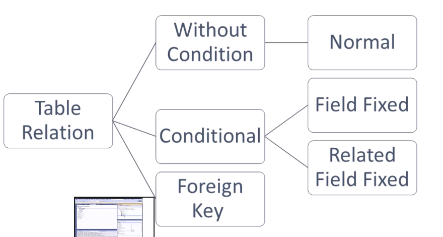
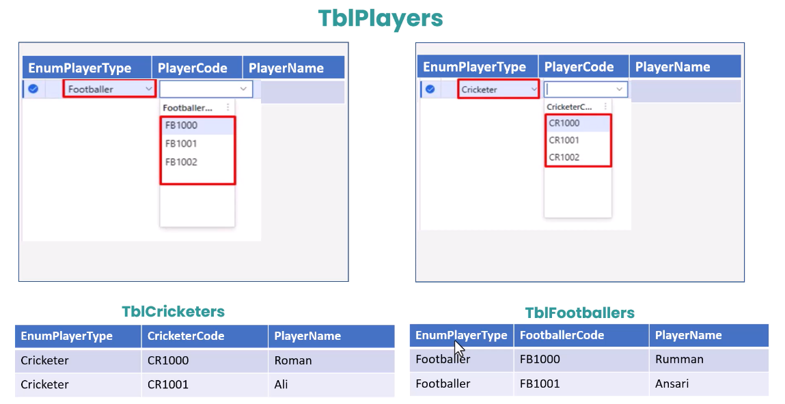
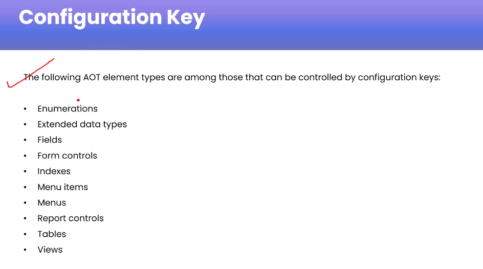


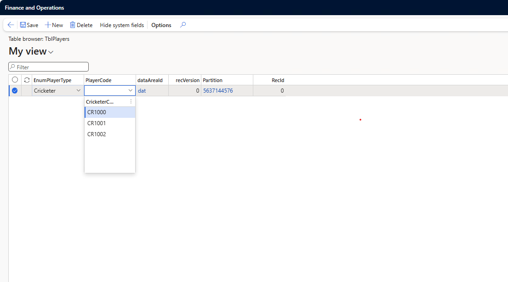


Data Selection and Manipulation
______

```x++
 public static void DataSelection1()
 {
     CustTable custTable;

     select firstonly custTable; //this is a short notation for select firstonly * from custTable
     info(strFmt("Customer account number: %1", custTable.AccountNum));
 }

 public static void DataSelection2()
 {
     CustTable custTable;

     while select firstonly10 custTable
     {
         info(strFmt("Customer account number: %1", custTable.AccountNum));
     }
 }

```

The select statement fetches or manipulates data from the database. The select statement fetches only one record, or field. To fetch or traverse multiple records, you can use the **next** statement or the **while select** statement.

The **next** statement fetches the next record in the table. If you use a next statement, don't use the firstOnly find option. It's more appropriate to use a while select statement to traverse multiple records.

The results of a select statement are returned in a table buffer variable.

The next statement fetches the **next record** in the table.

It's more appropriate to use **while select**

Data Insertion
_______

```x++
    public static void Insertion1()
    {
        KokoEmployeeTable employeeTable;

        ttsbegin;
        employeeTable.KokoEmployeeId                = 1;
        employeeTable.FirstName                     = "John";
        employeeTable.LastName                      = "Doe";
        employeeTable.EmployeeGender                = GenderMaleFemale::Male;
        employeeTable.Salary                        = 50000;
        employeeTable.KokoEmployeeDesignation        = "Software Engineer";
        employeeTable.insert();
        ttscommit;
    }
```

The insert method inserts one record at a time. It generates values for the RecId field and system fields, and then inserts the contents of the buffer (that is , the column values) into the database.


ARRAY
______
It can store both homogeneous and heterogeneous data i.e data of same types or different types unlike C# which is homogenous.

Index of an array in X++ starts from 1 and not 0 like C#

```x++
public void Arrays()
{
    int myArray[5]; // fixed-size array with 5 elements
    myArray[1] = 10;
    myArray[2] = 20;
    myArray[3] = 30;
    myArray[4] = 40;
    myArray[5] = 50;
    for (int i = 1; i <= 5; i++)
    {
        info(strFmt("Element %1: %2", i, myArray[i]));
    }

    // OR dimOf() function can be used to get the size of the array if the array is declared with a fixed size.
    for (int i = 1; i <= dimOf(myArray); i++)
    {
        info(strFmt("Element %1: %2", i, myArray[i]));
    }
} 
```

dimOf() function is intended for X++ arrays that are declared as the following X++ primitive types only.
- boolean
- date
- int
- int64
- real
- utcDatetime

Array is a composite data type useful for aggregating values of primitive data type.


Collection Class
______
Collection classes are used to store objects. They let you create array,list,map and structure that can hold any kind of data type. 

Collection classes have dynamic size while native x++ requires a fixed size and sizing them can be less convenient.

Collection classes allows you to create collections that store a variety of data types within the same array while native array are typically homogeneous and meaning they store element of the same data type. 

Collection class comes with lots built-in methods. They are most compatible with certain scenario or libraries. 

Try to use the collection classes.

```x++
 public void Collections_Arrays()
 {
     Array myArray = new Array(Types::Integer);
     myArray.value(1, 10);
     myArray.value(2, 20);
     myArray.value(3, 30);

     //  accessing elements using the value() method
     info(strFmt("Element 1: %1", myArray.value(1)));

     for (int i = 1; i <= myArray.lastIndex(); i++)
     {
         info(strFmt("Element %1: %2", i, myArray.value(i)));
     }
 }

```

CONTAINER
______

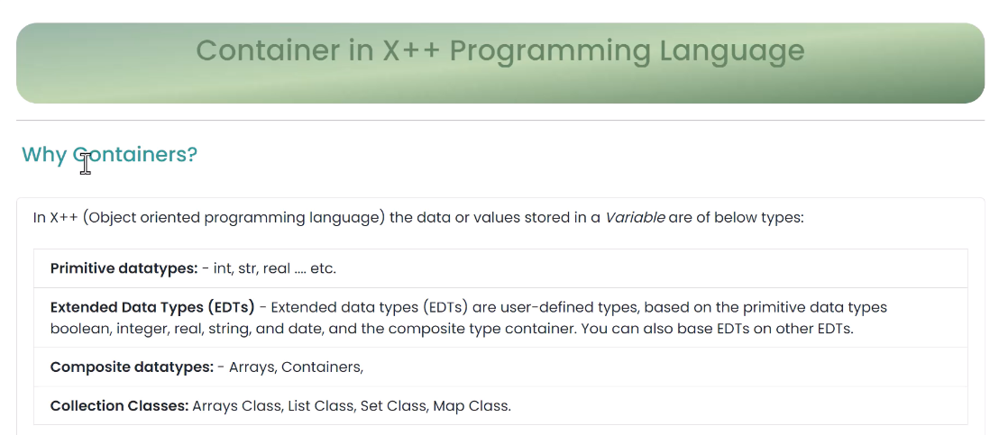

It's a composite data type.

Container stores many elements of different data types. However there are few limitations with Containers like "container cannot store objects" and "performance implications" and they can be addressed by collection classes and temporary table concepts. Containers are most frequently used in AX development so let us explore Containers and its features.

- In X++, container is one of the primitive types or value types. Container is not a class
- A container is a composite data type
- A container is a dynamic list of items containing primitive data types and/or some composite data types.
- A container contains an ordered sequence of primitive values or other containers. 
- A container can be stored in the database. Container is one of the column types that you can select when you use the AOT to add a column to a table.
- A container slightly resembles an array or collections such as the List or Stack classes. However, you can never change the size or content of a container after the container is created.
- A container is 1 based not 0 based. Indexing is 1 based for arrays and for everything else in X++
- A container is not a class therefore classes/objects cannot be passed/put into a container
- A container contains an ordered sequence of values (primitive data types - int, str, real, date, Boolean, enums etc) or other containers or/and some composite data types.
- A container is a "PASS BY VALUE" types not "PASS BY REFERENCE" type which means while passing container the copy of container with values is passed not the reference.
- A container is IMMUTABLE which means a container is never modified with any functions rather all X++ statements acting on a container are internally building a new container. In a simple terms we can say X++ statements that appear to modify a container are internally building a new container and copying values as necessary. Even an assignment of a container to another container variable creates a new copy of the container. 

For example assignment of a container to another container variable and container functions such as *conIns()*, *conDel()*, *conPoke()*, += etc. are actually creating a new copy of the container. 

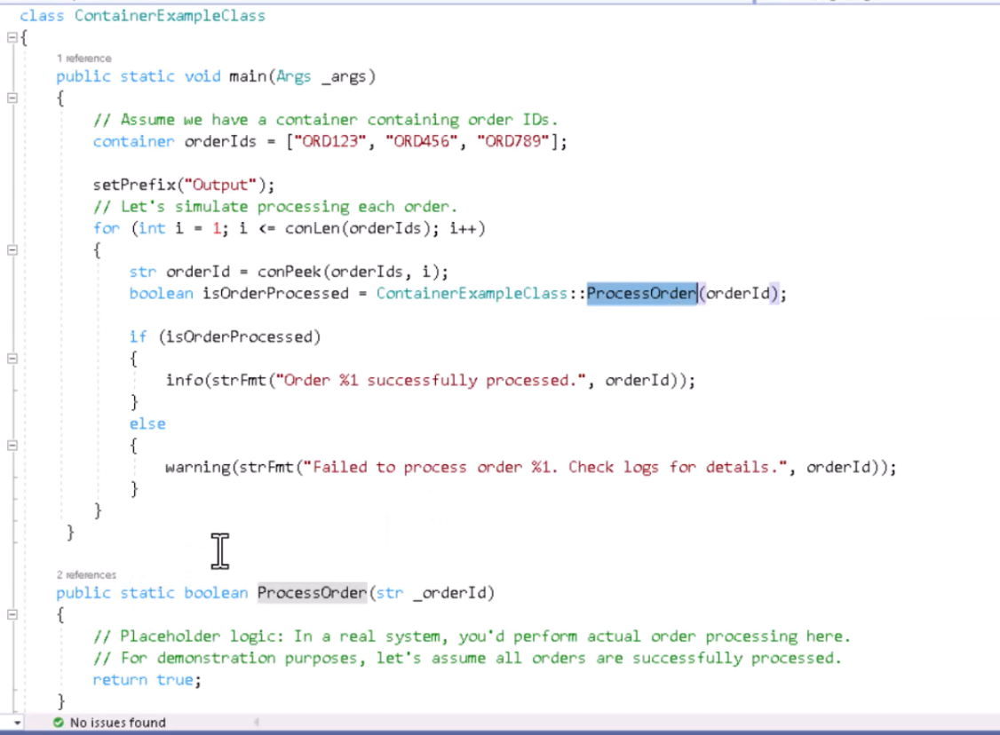

+= is faster than the conIns() function, however note that it inserts at the end after last index location. Therefore use this operation when insertion has no relevance to index position especially used in loops. 

LIST
_____

Allows you to store manage a collection of items or elements of the same type.

RECORDINSERTLIST
______
It allow you to efficiently insert multiple record into a single database operation. RecordInsertList is a powerful X++ class that allows you to efficiently insert multiple records into a single database operation.

This can significantly improve performance compared to inserting records one by one especially for large datasets.

SET
____
Set object is stored the value in a manner that optimizes the performance for each method. So it's like Math sets, where we have methods like union, intersect, in.

```x++
 Set mySet = new Set(Types::String)
```

```
 Set::union(setA, setB);-
```

For SET objects, if any elements are added or removed after an iterator is created, the iterator instance can no longer be used to read from or step through the collection. 

MAP
_____
The Map class lets to associate one value (the key) with another value.

A Map in X++ stores key/value pairs. Keys are unique, and adding an existing key overwrites its value.


```X++
Map map = new Map(Types::String, Types::Integer);   // key type, value type

map.insert("A", 1);                 // add or overwrite
map.insert("B", 2);

if (map.exists("A"))                // check key
    info(int2Str(map.lookup("A"))); // get value (errors if key missing)

map.remove("B");                    // delete by key

// Iterate
MapEnumerator me = map.getEnumerator();
while (me.moveNext())
{
    info(strFmt("%1 = %2", me.currentKey(), me.currentValue()));
}
```

Types: both key and value types are set in the constructor (Types::String, Types::Integer, Types::Class, Types::Record, and so on).   

Lookup: lookup() throws an error if the key doesn’t exist, so check exists() first.  

Order: don’t rely on any order when enumerating.   

Removing while iterating: avoid it. Collect the keys first, then remove them after the loop.  

Other methods: elements() returns the count, keys() returns a Set of the keys, and insert() on an existing key replaces the old value.  

Common uses: caching lookups such as CustTable values, grouping or aggregating data, and passing parameters. Map is also used with Types::Record for record caching.  

Also for Map objects, as for Set objects, if any elements are removed, the iterator is no longer valid.

Map to a Class.

```x++
class MyCustInfo
{
    CustAccount accountNum;
    Amount      balance;
}

Map          map = new Map(Types::String, Types::Class);
MyCustInfo   info1 = new MyCustInfo();

info1.accountNum = "C001";
map.insert("C001", info1);

// Retrieve (cast back to the class)
MyCustInfo found;
if (map.exists("C001"))
{
    found = map.lookup("C001") as MyCustInfo;
}

// Iterate
MapEnumerator me = map.getEnumerator();
while (me.moveNext())
{
    MyCustInfo obj = me.currentValue() as MyCustInfo;
    info(obj.accountNum);
}
```

CONSTRUCTORS
______

In X++, the name of the constructor can't be same name as the class name unlike in C#. The constructor name in X++ is **new**.


```x++
 class Person
 {
    str firstName;
    str lastName;

    public void new(str _firstName, str _lastName)
    {
       firstName = _firstName;
       lastName  = _lastName;     
    }
 }
```

```x++
internal final class Person
{
    str firstName;
    str lastName;

    public void new(str _firstName, str _lastName)
    {
        firstName = _firstName;
        lastName = _lastName;
    }

    // constructor another way to create a constructor
    public static Person construct(str _firstName, str _lastName)
    {
        Person person = new Person(_firstName, _lastName);
        return person;
    }

    // method
    public void Person(str _firstName, str _lastName)
    {
        firstName = _firstName;
        lastName = _lastName;
    }
}

```

X++ does not supports constructor overloading, which means you can't define multiple constructors with different parameter lists. This provides 
flexibility when creating objects.

Advanced.
```x++
class MyCustInfo
{
    CustAccount accountNum;
    Amount      balance;

    // Constructor: keep it protected
    protected void new()
    {
    }

    // Static construct: the public entry point
    public static MyCustInfo construct()
    {
        return new MyCustInfo();
    }

    // Static new-style method when parameters are needed
    public static MyCustInfo newFromAccount(CustAccount _accountNum)
    {
        MyCustInfo info = MyCustInfo::construct();
        info.parmAccountNum(_accountNum);
        return info;
    }

    public CustAccount parmAccountNum(CustAccount _accountNum = accountNum)
    {
        accountNum = _accountNum;
        return accountNum;
    }
}

// Usage
MyCustInfo info = MyCustInfo::newFromAccount("C001");
```

No overloading: X++ doesn’t support constructor overloading. Use differently named static methods (newFromAccount, newFromRecord) for different inputs.  

new() is protected: this forces callers to use the static methods, so you can validate input, return a subclass, or change creation logic later without breaking callers.   

construct(): takes no parameters and just returns new ClassName(). It is also where you can pick a subclass (a factory pattern).  

parm methods: set values after construction, via parm accessors (which act as both getter and setter).  

Inheritance: call super() in a subclass new() if it needs to run the parent constructor logic.  

Extension: a protected new() plus construct() also works well with Chain of Command, because construct() is easier to wrap than a direct new. 

Framework classes: RunBase/SysOperation classes follow the same pattern, with construct() plus main() as the entry point.  

METHODS
_____

```x++
public class Person
{
    str firstName;
    str lastName;

    protected void methodProtected()
    {
        info("This is a protected method.");
    }

    public void methodProtected1()
    {
        info("This is a protected method.");
    }

    protected void methodProtectedWithParameters(str _param1, int _param2)
    {
        info(strFmt("This is a protected method with parameters: %1, %2", _param1, _param2));
    }

    protected int methodProtectedWithReturnValue(int _a, int _b)
    {
        int c = _a + _b;
        return c;
    }

}

public class Developer extends Person
{
   public void methodProtected1()
   {
       // the super keyword is used to call the method from the parent class (Person) else it will call the method from the current class (Developer)
       super();
       info("This is a public method from the Developer class.");
   }

    public void methodProtected()
    {
        // no super keyword is used here, so it will call the method from the current class (Developer)
        info("This is a public method from the Developer class.");
    }

}
```

**X++ and method overloading**

X++ does not support method overloading. A class can't have two methods with the same name and different parameter lists, and doing so is a compile error.

Workarounds:
- Use default parameter values, e.g. `void process(str _name, int _qty = 1)`.
- Use distinct method names, e.g. `processByCustomer()` and `processByVendor()`.
- Pass a contract or parameter class that holds the optional values.

**Overriding**

A subclass can override a base-class method if the name and signature match exactly.

```x++
class BaseCalculator
{
    public real calcTax(real _amount)
    {
        return _amount * 0.10;
    }
}

class DeCalculator extends BaseCalculator
{
    // Overrides the base method: same name and signature
    public real calcTax(real _amount)
    {
        return _amount * 0.19;
    }
}

// Usage
BaseCalculator calc = new DeCalculator();
info(strFmt("%1", calc.calcTax(100)));   // 19, resolved at runtime
```

To extend the base logic instead of replacing it, call `super()`:

```x++
public real calcTax(real _amount)
{
    real baseTax = super(_amount);
    return baseTax + 5;   // add a surcharge on top of the base result
}
```

Chain of Command (`[ExtensionOf]` with `next`) wraps an existing method. It is extension, not overloading.

ABSTRACT
_____

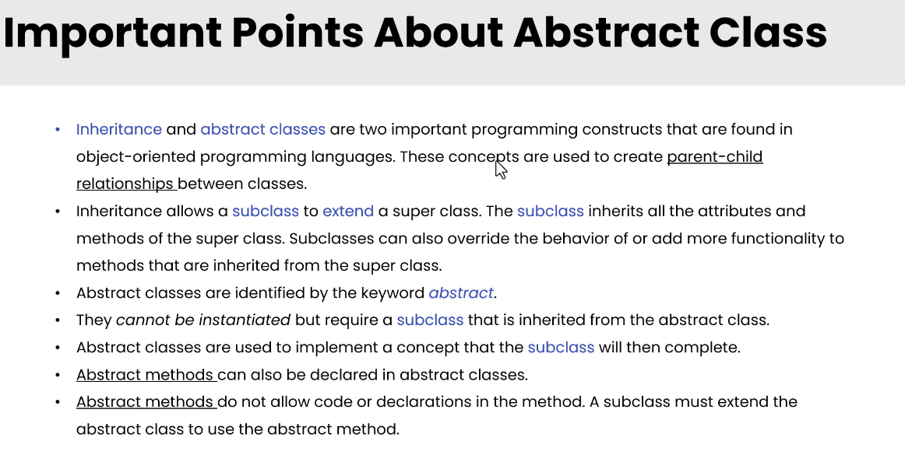

abstract class VehicleAbstractClass
{
    str owner = "Seun";
    int age   = 30;

   
    public void new(str _owner, int _age)
    {
        owner = _owner;
        age = _age;
        info(strFmt("Owner: %1, Age: %2", owner, age));
    }

   public void printInfo()
   {
       info(strFmt("Owner: %1, Age: %2", owner, age));
   }

   // Abstract method that must be implemented by derived classes
    abstract void startEngine(){}

} 
```

Implementing the Abstract class

```x++
class Car extends VehicleAbstractClass
{
    str model;
    public void new(str _owner, int _age, str _model)
    {
        super(_owner, _age);
        model = _model;
        info(strFmt("Model: %1", model));
    }

    // Implement the abstract method from the base class
    public void startEngine()
    {
        info("Car engine started.");
    }

}
```

INTERFACES
______
Interfaces

An interface declares method signatures only, written with an empty body {}. Every method is public. Any implementing class must provide all of them with the exact same signature. The same no-overloading rule applies, so an interface can’t declare two methods with the same name.

```x++
interface ITaxCalculator
{
    public real calcTax(real _amount) {}
}

class DeTaxCalculator implements ITaxCalculator
{
    public real calcTax(real _amount)
    {
        return _amount * 0.19;
    }
}

class FrTaxCalculator implements ITaxCalculator
{
    public real calcTax(real _amount)
    {
        return _amount * 0.20;
    }
}

// Usage: program against the interface, not the concrete class
ITaxCalculator calc = new DeTaxCalculator();
info(strFmt("%1", calc.calcTax(100)));   // 19

```

A class can extend one base class and implement several interfaces:

x++
class MyCalc extends BaseCalculator implements ITaxCalculator, SysPackable

Chain of Command ([ExtensionOf] with next) wraps an existing method. It is extension, not overloading.

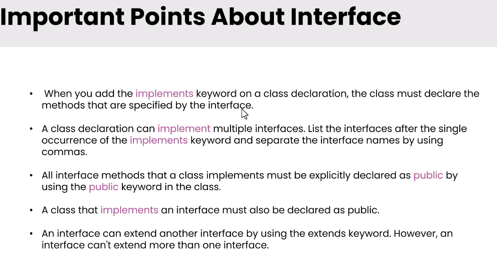

TABLE METHODS
____________


There are 2 types of tables in D365FO, STANDARD tables (already existing tables in the D365FO) and CUSTOM tables (created by us). Tables have methods and we can create our own methods or override existing methods.

In Microsoft Dynamics 365 FO, table methods are used to perform specific operations on a table. They are defined within the table itself and can be called from any other object within the application.

Table methods can be used to perform tasks such as data validation, calculations and database operations. They are often used in combination with form methods and class methods to provide functionality to the user interface and business logic of the application.

The base class of all tables is common in X++

```x++
public class KokoEmployeeTable extends common
{
    /// <summary>
    /// Determines if concurrent deletes should throw exception.
    /// </summary>
    /// <returns>true, if exception should be thrown; otherwise, false.</returns>
    public boolean shouldThrowExceptionOnZeroDelete()
    {
        return true;
    }

}
```

**initValue** Method
______

initializes a field to the default value. If we create a new record from the table browser or a form the table method initValue() is executed.

```x++
public void initValue()
```

```x++
public class KokoEmployeeTable extends common
{
    /// <summary>
    ///
    /// </summary>
    public void initValue()
    {
        super();

        this.Salary = 1000;
        this.FirstName = "Sola";
        this.LastName = "Oluwaseun";    
        this.EmployeeGender = GenderMaleFemale::Male;
    }

}
```


```x++
public class KokoEmployeeTable extends common
{
    /// <summary>
    ///
    /// </summary>
    public void initValue()
    {
        super();

        //this.Salary = 1000;
        //this.FirstName = "Sola";
        //this.LastName = "Oluwaseun";    
        //this.EmployeeGender = GenderMaleFemale::Male;

        // OR we can also apply conditions to the initValue method as shown below
        if(this.EmployeeGender == GenderMaleFemale::Male)
        {
            this.Salary = 1000;
        }
        else
        {
            this.Salary = 500;
        }
    }

}

```

Then sync the DB , build it and you can open table browser on the table to see it in actions.


**modifiedField** Method
______

Executed when a field is modified in a form or Web form. Use this instead of placing code on the Form control/form data source field. Each time the value of a field is changed the method modifiedFiled() is called. It is useful to initializer the values of other fields if the value of the current field is changed.


```x++
public void modifiedField(FieldId fieldId)
```

```x++
public class KokoEmployeeTable extends common
{
    /// <summary>
    ///
    /// </summary>
    /// <param name = "_fieldId"></param>
    public void modifiedField(FieldId _fieldId)
    {
        info(strFmt("%1", _fieldId)); // you will be able to see the Id like 1,2,3
        info(strFmt("Field modified: %1", fieldId2Name(this.TableId, _fieldId))); // you will be able to see the name of the field modified like FirstName, LastName, Salary, EmployeeGender

        super(_fieldId);

        switch(_fieldId)
        {
            case fieldNum(KokoEmployeeTable, EmployeeGender):
                info(strFmt("Employee Gender: %1", this.EmployeeGender));
                if(this.EmployeeGender == GenderMaleFemale::Male)
                {
                    this.Salary = 1000;
                }
                
                if(this.EmployeeGender == GenderMaleFemale::Female)
                {
                    this.Salary = 500;
                }
                break;
              
        }
    }

}
```

**modifiedFieldValue** Method
______

Executed when a field is modified in a form or Web form. Use this instead of placing code on the form.

Each time the value of a field is changed the method modifiedFieldValue() is called. It is useful to initialize the values of other fields if the value of the current field is changed.

The code in the modifiedFieldValue method is executed without writing into the DB.

The modifiedFieldValue method only executes if validation returns true. 

```x++
public void modifiedFieldValue(FieldName fieldName, [int arrayIndex])
```


```x++
public class KokoEmployeeTable extends common
{
    /// <summary>
    ///
    /// </summary>
    /// <param name = "_fieldName"></param>
    /// <param name = "_arrayIndex"></param>
    public void modifiedFieldValue(FieldName _fieldName, int _arrayIndex = 1)
    {
        super(_fieldName, _arrayIndex);
        info(strFmt("Field modified: %1", _fieldName)); // you will be able to see the name of the field modified like FirstName, LastName, Salary, EmployeeGender
        super(_fieldName, _arrayIndex);

        switch(_fieldName)
        {
            case fieldStr(KokoEmployeeTable, EmployeeGender):
                info(strFmt("Employee Gender: %1", this.EmployeeGender));
                if(this.EmployeeGender == GenderMaleFemale::Male)
                {
                    this.Salary = 1000;
                }
                
                if(this.EmployeeGender == GenderMaleFemale::Female)
                {
                    this.Salary = 500;
                }
                break;
              
        }
    }

}
```

**validateField** Method
______

Determines whether the specified field is valid. Method validateField() is used for validation only and will return true or false.

If the return value is false, the application user will be prevented to continue changing a field value.

```x++
public boolean validateField(FieldId fieldIdToCheck)
```

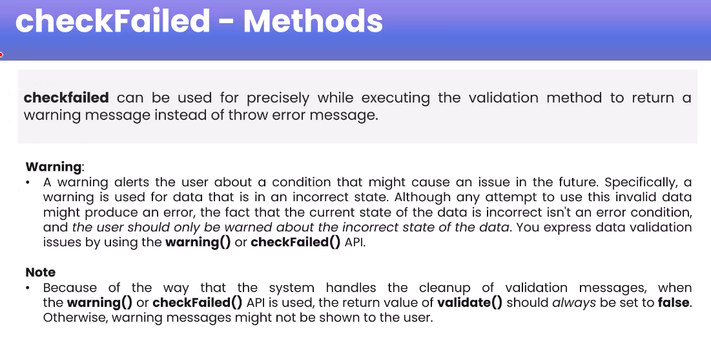